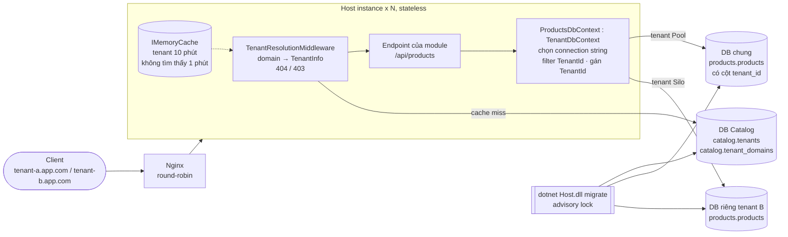

# Kiến trúc

## Tổng quan

## Thành phần

| Project | Vai trò | Được tham chiếu bởi |
|---|---|---|
| `Shell.Abstractions` | `IModule`, `AddModuleDbContext`, `IMustHaveTenant`, `TenantInfo`, `ITenantContext`, `TenantDbContext` | Shell.Core, mọi module |
| `Shell.Core` | Nạp module; Catalog, phân giải tenant, cache; lệnh `migrate`; health check | Host |
| `Host` | `Program.cs`: Serilog, pipeline, Swagger (dev), lệnh `migrate` | — |
| `Modules.X` | Nghiệp vụ của module X (internal) | Host (chỉ để copy DLL) |
| `Modules.X.Contracts` | DTO/interface công khai của X | Module khác cần dùng X |

**Quy tắc phụ thuộc** (kiểm tra bằng `tests/Shell.UnitTests/ArchitectureTests.cs`): module chỉ dùng module khác qua `Modules.Y.Contracts`; module không dùng `Shell.Core`/`Host`, chỉ `Shell.Abstractions`.

## Module

- Mỗi assembly `Modules.*.dll` có đúng một class `IModule` (`Id`, `DependsOn`, `ConfigureServices`, `MapEndpoints`).
- Lúc khởi động: `ModuleLoader` quét DLL → `ModuleCatalog` kiểm tra id, trùng id, dependency thiếu, vòng lặp → sắp xếp topo. Lỗi → log `Fatal`, exit 1.
- Endpoint của module nằm dưới `/api/{Id}`. Module luôn bật; "module" chỉ là ranh giới code và dữ liệu (schema riêng).

## Multi-tenant Hybrid

### Ba loại database

| DB | Nội dung | Kết nối |
|---|---|---|
| **Catalog** (master) | `catalog.tenants` (id, name, is_active, is_isolated_db, connection_string), `catalog.tenant_domains` (domain unique → tenant) | Cố định: `ConnectionStrings:Catalog` |
| **Shared** (Pool) | Bảng của mọi module, dữ liệu của mọi tenant Pool, phân biệt bằng `tenant_id` | `ConnectionStrings:DefaultShared` |
| **Silo** (mỗi tenant một DB) | Cùng bảng như Shared, chỉ chứa dữ liệu một tenant | `tenants.connection_string` |

Mỗi DB Shared/Silo có đủ schema của mọi module (`products`, ...), mỗi schema có bảng `__ef_migrations_history` riêng.

### Luồng một request

1. `TenantResolutionMiddleware` bỏ qua `/health`, `/swagger`.
2. Lấy domain: header `X-Tenant-Host` (chỉ khi `AllowHostHeaderOverride`) hoặc `Request.Host`, chuẩn hoá (chữ thường, bỏ port).
3. `TenantStore`: tra `IMemoryCache`; miss thì query Catalog, cache 10 phút. Không tìm thấy → cache "không có" 1 phút.
4. Không có tenant → **404**; `IsActive = false` → **403** (ProblemDetails).
5. Gán `TenantContext` (scoped) và thêm `TenantId` vào log scope.
6. Endpoint inject DbContext của module. `AddModuleDbContext` hỏi `ITenantConnectionStringProvider`: tenant Silo → connection string riêng (thiếu thì báo lỗi, **không** rơi về DB chung); tenant Pool → `DefaultShared`.
7. `TenantDbContext`:
   - **Đọc**: mọi entity `IMustHaveTenant` có filter `TenantId == tenant hiện tại`. Không có tenant → không thấy dòng nào.
   - **Ghi** (`SaveChanges`): `Added` → tự gán `TenantId`; `TenantId` khác tenant hiện tại → lỗi; `Modified/Deleted` đổi `TenantId` hoặc thuộc tenant khác → lỗi; chưa có tenant → `InvalidOperationException`.

Filter vẫn áp dụng trong DB Silo (an toàn hai lớp).

### Scale ngang

- Instance không giữ state ngoài cache có hạn (tenant). Nginx round-robin, không sticky session.
- Thay đổi trong Catalog lan tới mọi instance trong tối đa `CacheMinutes`.
- Npgsql pool connection theo từng connection string, nên mỗi DB Silo có pool riêng trong mỗi instance.

## Lệnh `migrate`

`dotnet Host.dll migrate` dùng cùng cấu hình và danh sách module với app, rồi:

1. Tạo DB Catalog nếu chưa có.
2. Lấy `pg_advisory_lock` trên DB Catalog (nhiều job chạy cùng lúc sẽ xếp hàng).
3. Migrate Catalog → seed tenant demo (nếu `SeedDemoTenants`).
4. Migrate DbContext của mọi module (theo thứ tự dependency) trên DB **Shared**.
5. Với từng tenant Silo: migrate các DbContext đó trên DB riêng (EF tự tạo DB nếu chưa có).

Không bao giờ chạy lúc khởi động app.

## Production readiness

| Mục | Cách làm |
|---|---|
| Health | `/health/live` (không check), `/health/ready` (Catalog + Shared, timeout 5s) |
| Lỗi | ProblemDetails cho 400/403/404/500, không lộ stack trace ngoài Development |
| Log | Serilog JSON ra console, có `TenantId` trong scope của request |
| Shutdown | SIGTERM → chờ tối đa `ShutdownTimeoutSeconds`; compose `stop_grace_period: 35s` |
| Container | Multi-stage, `aspnet:10.0`, user `app` (non-root) |
| Cấu hình | appsettings + biến môi trường, validate khi khởi động |
